<div align="center">


# Memora

**Flashcards com repetição espaçada, local-first, sem conta e sem paywall.**

Crie decks, estude com SM-2 ou FSRS, use cloze, LaTeX, oclusão de imagem e IA, tudo no seu navegador e com os dados guardados com você.

[](LICENSE)


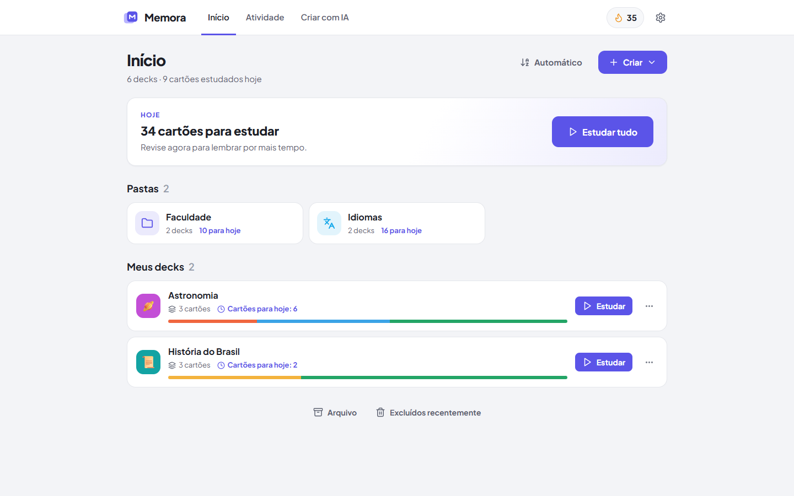

</div>

---

## Sumário

- [Por que o Memora](#por-que-o-memora)
- [Funcionalidades](#funcionalidades)
- [Capturas de tela](#capturas-de-tela)
- [Começando](#começando)
- [Seus dados](#seus-dados)
- [IA (opcional)](#ia-opcional)
- [Arquitetura](#arquitetura)
- [Como o projeto nasceu: engenharia reversa com o REA](#como-o-projeto-nasceu-engenharia-reversa-com-o-rea)
- [Contribuindo](#contribuindo)
- [Licença](#licença)

## Por que o Memora

- **Grátis de verdade.** Não há plano pago nem limite diário de estudo, de cartões ou de imagens.
- **Local-first.** Funciona offline e sem cadastro. Os dados ficam no seu navegador e, se você quiser, num arquivo de backup no seu disco.
- **Completo.** Tem editor rico, cloze, LaTeX, oclusão de imagem com detecção de texto, TTS, FSRS, importação do Anki e geração de cartões por IA.
- **Código aberto.** Licença MIT: use, estude, modifique e distribua.

## Funcionalidades

| Área | O que você pode fazer |
|---|---|
| **Decks** | pastas com ícone e cor, subdecks, duplicar com ou sem progresso, mover, arquivar e lixeira de 30 dias |
| **Cartões** | básico, reverso, cloze (lacunas) e oclusão de imagem, com busca, filtros, ordenação, seleção múltipla e congelamento |
| **Editor rico** | negrito, itálico, realce e cor, listas, código, links, **LaTeX** (KaTeX), imagens, **busca de imagens** (Wikimedia Commons), desenho à mão livre e trechos para TTS |
| **Oclusão de imagem** | desenhe áreas ou deixe o **OCR** (tesseract.js) detectar o texto e criar as áreas sozinho, nos modos "esconder todas" ou "esconder uma" |
| **Estudo** | Errei / Difícil / Bom / Fácil com prévia do intervalo, atalhos de teclado, digitar a resposta e editar ou congelar durante a sessão |
| **Algoritmos** | SM-2 geral, **FSRS** (ts-fsrs), aprendizado rápido, idiomas, medicina e personalizado (passos, multiplicadores e limites) |
| **Importar e exportar** | colar texto com separadores configuráveis, CSV, TXT, **Anki `.apkg`**, exportação CSV/JSON com progresso |
| **Engajamento** | sequência de dias, meta diária, congelamentos de sequência, calendário de atividade e imagem da sequência |
| **Personalização** | tema claro, escuro ou do sistema, e estilo do cartão por deck (fonte, tamanho, alinhamento, incluindo OpenDyslexic) |
| **IA** | gerar cartões a partir de um tema, de um texto ou de um PDF, usando a sua própria chave da API da Anthropic |

## Capturas de tela

### Estudo

| Revisão com repetição espaçada | Fórmulas em LaTeX |
|---|---|
| 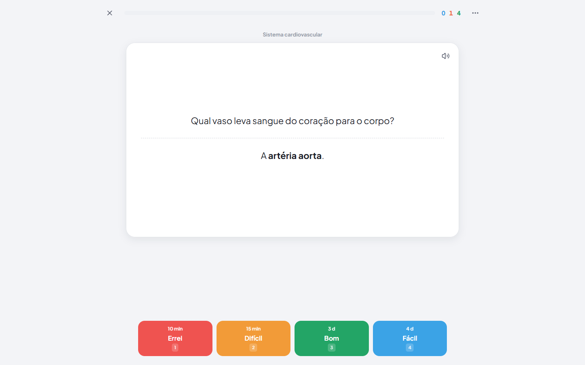 | 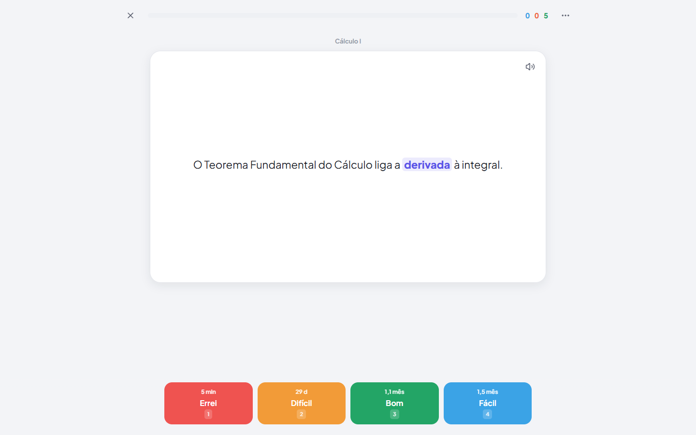 |

| Oclusão de imagem | Tema escuro |
|---|---|
| 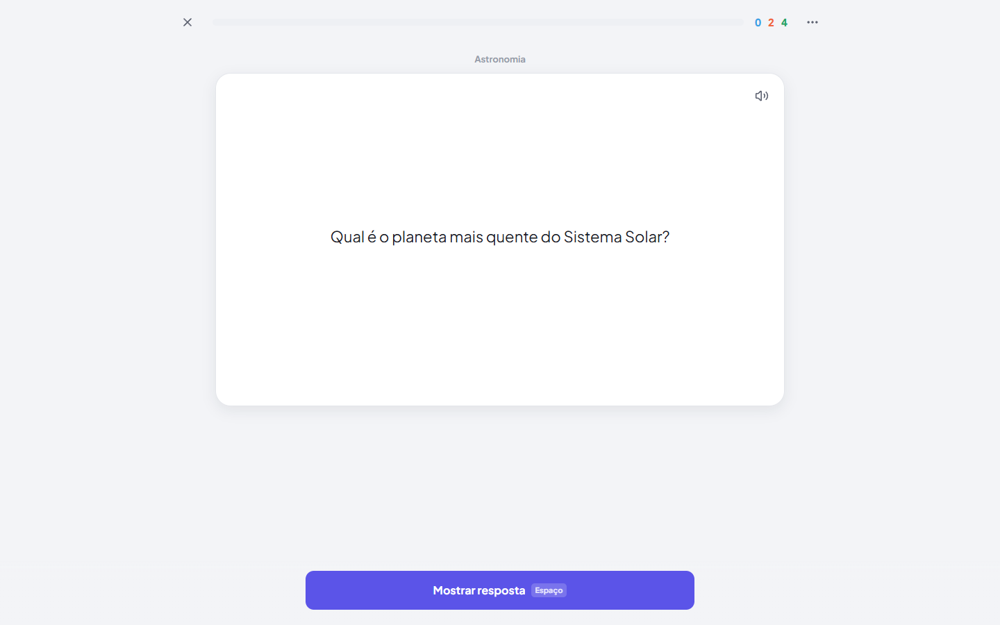 | 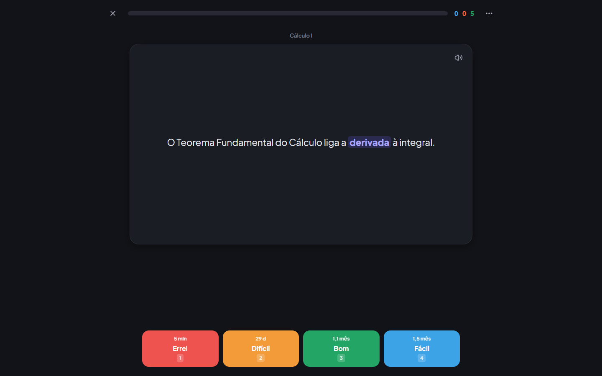 |

### Decks e cartões

| Visão geral do deck | Lista de cartões |
|---|---|
| 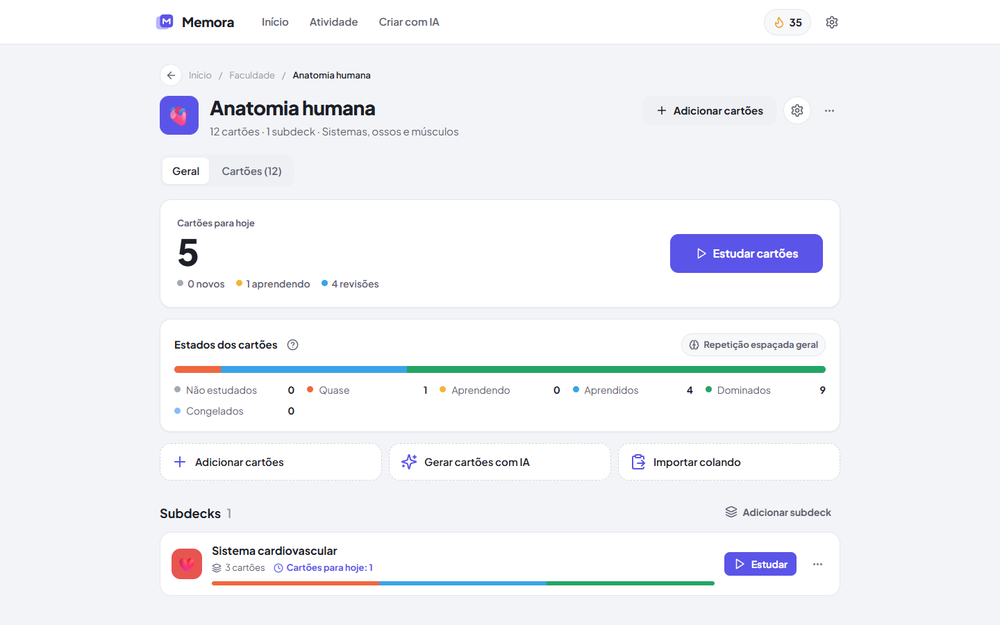 | 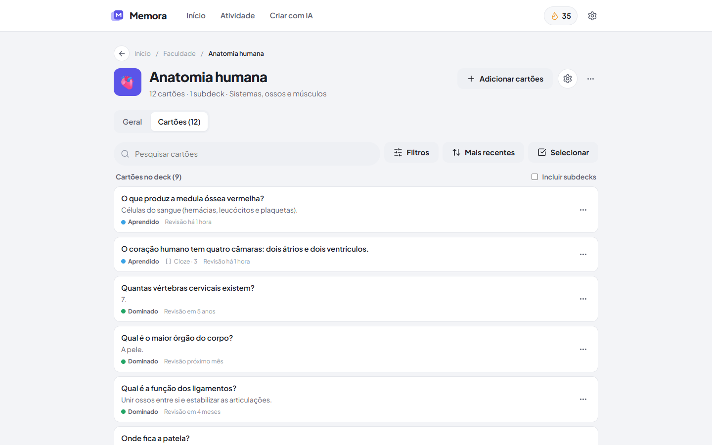 |

| Editor rico com cloze e LaTeX | Importação colando texto |
|---|---|
| 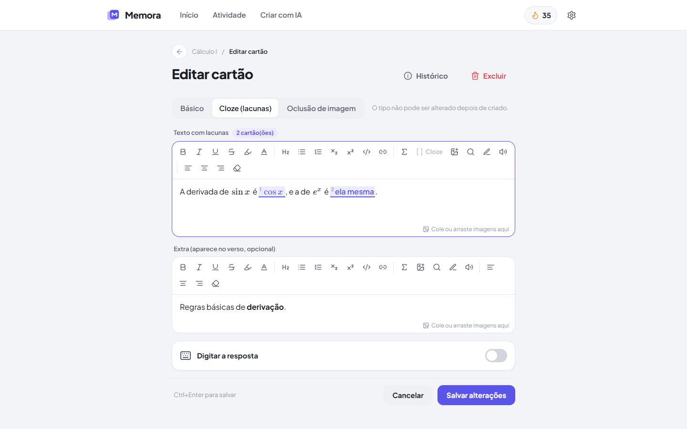 | 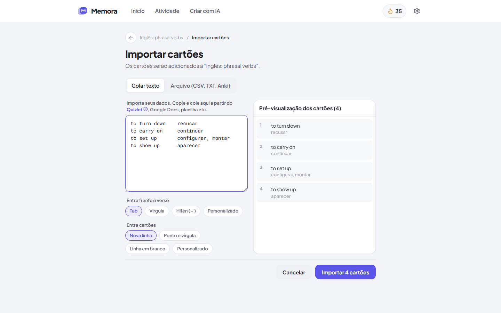 |

### Algoritmos, atividade e IA

| Escolha do algoritmo | Atividade e sequência |
|---|---|
| 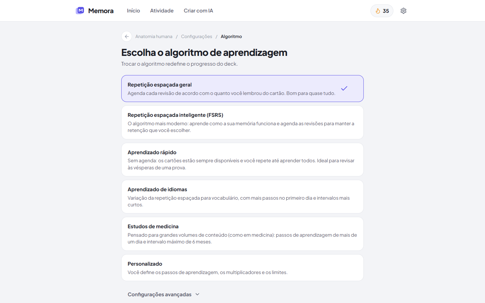 | 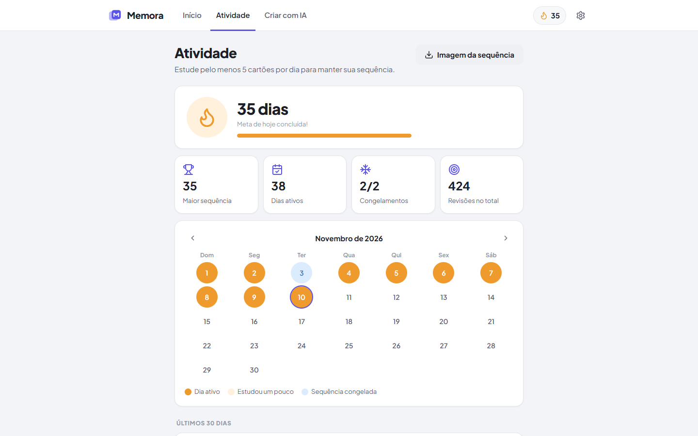 |

| Gerador de cartões com IA | Início no tema escuro |
|---|---|
| 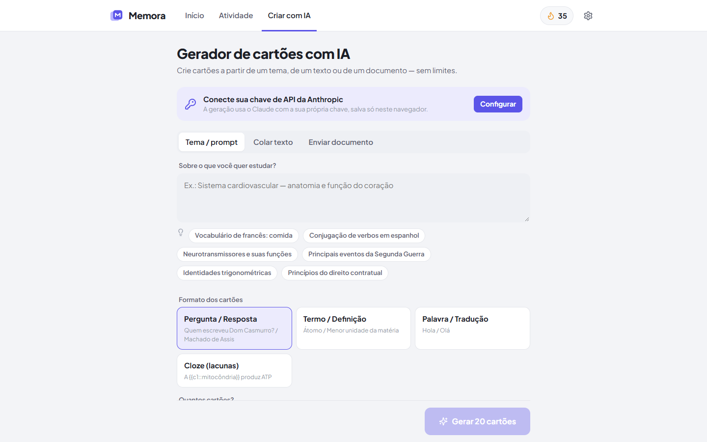 | 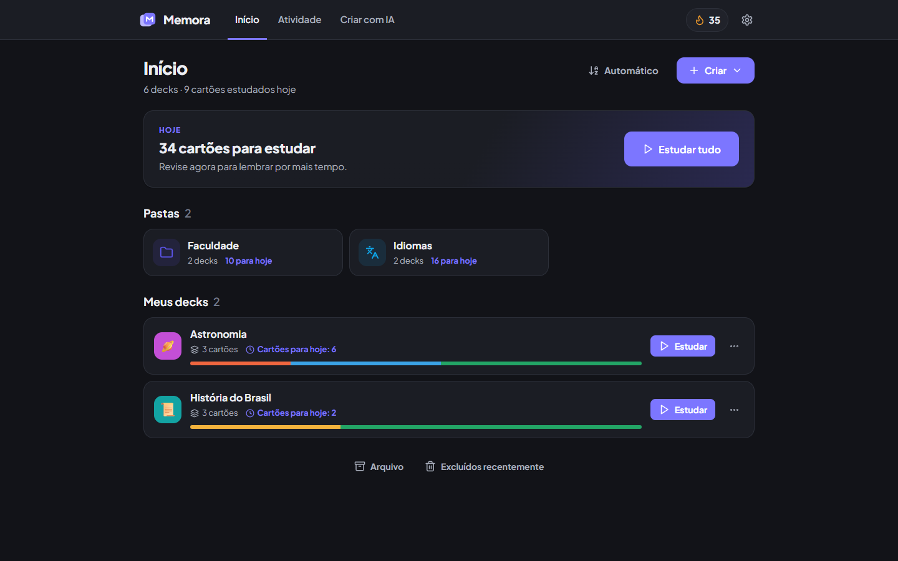 |

### Mobile

<p align="center">
  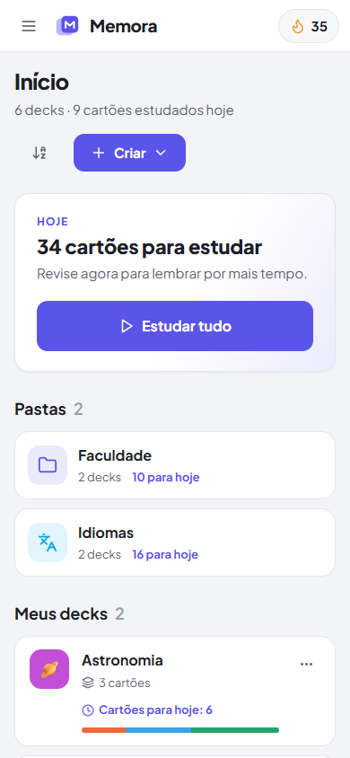
  &nbsp;&nbsp;
  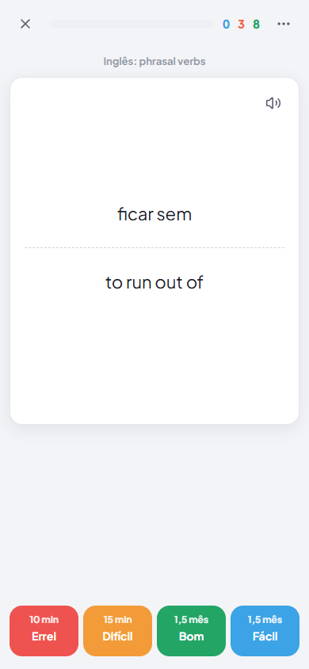
</p>

## Começando

Requer **Node.js 22.23+ ou 24.22+**.

```bash
git clone https://github.com/asafeareas/memora-flashcards.git
cd memora-flashcards
npm install
npm run dev
```

Abra http://localhost:5180.

| Comando | O que faz |
|---|---|
| `npm run dev` | servidor de desenvolvimento (porta 5180) |
| `npm run build` | checagem de tipos e build de produção em `dist/` |
| `npm run preview` | serve o build de produção (porta 5181) |
| `npm test` | testes com Vitest |
| `npm run typecheck` | só a checagem de tipos |

O build é estático: `dist/` pode ir para qualquer hospedagem de arquivos (GitHub Pages, Netlify, Vercel, Cloudflare Pages).

## Seus dados

O Memora não tem servidor. Os dados ficam em três camadas:

1. **IndexedDB** (via Dexie), gravado a cada ação, com armazenamento persistente solicitado ao navegador.
2. **Backup automático em arquivo** (Chrome e Edge): em *Configurações → Seus dados*, escolha um arquivo uma vez. O app o regrava a cada alteração, e ele sobrevive a "limpar dados do site".
3. **Restauração**: se o app abrir vazio, ele oferece restaurar a partir do backup. Exportar e importar manualmente também funciona.

## IA (opcional)

Em *Configurações → Inteligência artificial*, informe sua chave da API da Anthropic. A chave fica só neste navegador e não entra nos backups. A geração usa `claude-opus-5-5` com saída estruturada. Sem chave, todo o resto funciona normalmente.

## Arquitetura

| Camada | Tecnologia |
|---|---|
| Build | Vite 6 + TypeScript 5.9 |
| UI | React 18 + React Router 6, ícones Lucide |
| Dados | Dexie 4 (IndexedDB) com consultas reativas (`useLiveQuery`) |
| Editor | Tiptap 2 (ProseMirror) com extensões próprias de cloze, LaTeX e TTS |
| Agendamento | SM-2 com passos + ts-fsrs |
| Importação | PapaParse (CSV), JSZip + sql.js (Anki) |
| OCR | tesseract.js |
| IA | @anthropic-ai/sdk + zod |
| Testes | Vitest + fake-indexeddb |

```
src/
  db/          schema Dexie e repositórios (decks, notas, cartões, revisões, mídia)
  domain/      regras puras: agendadores, fila de estudo, cloze, importação e exportação, backup
  editor/      editor rico, oclusão de imagem, desenho e busca de imagens
  components/  primitivos de UI (botões, modais, menus, toasts, abas)
  features/    telas: início, deck, editor, estudo, atividade, configurações, IA
  styles/      tokens de design e temas
```

Mais detalhes em [`docs/02-arquitetura.md`](docs/02-arquitetura.md).

## Como o projeto nasceu: engenharia reversa com o REA

O Memora começou como um estudo de engenharia reversa. Usamos o **[REA](https://www.npmjs.com/package/rea-agents)** para analisar a versão web de um aplicativo comercial de flashcards e mapear as funções que um app desse tipo oferece: navegação por cenários no navegador, inspeção do DOM e da árvore de acessibilidade, análise do bundle JavaScript e exportação dos scripts.

A partir desse mapa, o Memora foi escrito do zero, com código, nome e identidade visual próprios. Nenhum código, texto ou recurso gráfico do app analisado foi copiado. O REA também foi usado para validar o próprio Memora com cenários automatizados de ponta a ponta em desktop e mobile.

| Documento | Conteúdo |
|---|---|
| [`docs/01-engenharia-reversa.md`](docs/01-engenharia-reversa.md) | método com o REA, funcionalidades mapeadas e limitações |
| [`docs/02-arquitetura.md`](docs/02-arquitetura.md) | decisões, modelo de dados e persistência |
| [`docs/03-validacao.md`](docs/03-validacao.md) | cenários REA, testes e correções |
| [`docs/04-relatorio-final.md`](docs/04-relatorio-final.md) | relatório final |

## Contribuindo

Contribuições são bem-vindas.

1. Faça um fork e crie um branch: `git checkout -b minha-melhoria`.
2. Rode `npm test` e `npm run typecheck` antes de enviar.
3. Abra um pull request descrevendo o que mudou e por quê.

Achou um bug ou tem uma ideia? Abra uma [issue](https://github.com/asafeareas/memora-flashcards/issues).

## Licença

Distribuído sob a licença MIT. Veja [`LICENSE`](LICENSE).
